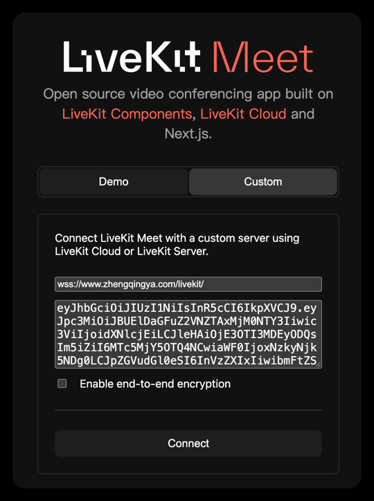
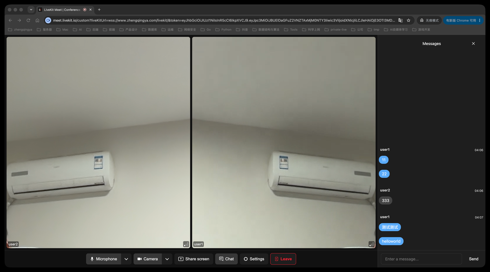

### LiveKit 1.13.10

IM 语音/视频通话服务，单节点部署，信令与管理 API 复用现有 HTTPS 域名。

### 一、启动

准备 HTTPS 站点，按下方端口表放行网络；NAT 环境需配置媒体端口映射及公网 IP 回流。

> 首次部署按下方“业务配置”修改密钥并确认公网 IP 配置。

运行

```shell
docker compose up -d
```

### 二、域名代理与端口

将 [Nginx 配置片段](nginx/livekit.conf.example) 放入现有 HTTPS `server` 内并重载，复用站点证书。

- 前端地址：`wss://www.zhengqingya.com/livekit/`，替换为实际域名。
- 信令代理 `/livekit/`：`proxy_pass http://127.0.0.1:7880/;` 末尾 `/` 用于剥离前缀。
- 管理代理 `/twirp/livekit.RoomService/`：`proxy_pass http://127.0.0.1:7880;` 末尾不加 `/`，保留完整请求路径并透传 `Authorization`。
- 音视频媒体直接连接服务器，云安全组和主机防火墙均需放行以下端口。

| 端口 | 用途 | 公网放行 |
| --- | --- | --- |
| `443/TCP` | HTTPS 管理 API / WSS 信令 | 是 |
| `7880/TCP` | LiveKit API，仅本机监听 | 否 |
| `7881/TCP` | ICE TCP 媒体回退 | 是 |
| `7882/UDP` | UDP 媒体 | 是 |
| `3478/UDP` | TURN / STUN | 是 |

**Docker bridge 容器直连宿主机 7880：** 给 Nginx/后端容器添加 `extra_hosts: ["host.docker.internal:host-gateway"]`，用 `host.docker.internal` 替换上游的 `127.0.0.1`。后端使用 HTTPS 域名时无需此配置。
同时将 LiveKit 的 `bind_addresses` 改为 `["0.0.0.0"]` 并重启，仅允许可信内网/Docker 网段访问 7880。

### 三、业务配置

- 公网 IP：[config/livekit.yaml](config/livekit.yaml) 默认通过 STUN 自动识别（`rtc.use_external_ip: true`），需允许 UDP 3478/19302 出站；公网 IP 变更后需重启重新探测。探测失败会导致启动失败，可按配置文件 TODO 手动指定实际公网 IPv4。
- 后端管理地址：`application-im.yml` 中 `im.rtc.api-url` 使用 `https://www.zhengqingya.com`，Mac 可直接通过 Nginx 调用管理 API，无需 SSH 隧道。Java/Kotlin SDK 使用根路径，地址不能带 `/livekit/` 前缀；同机后端也可直连 `http://127.0.0.1:7880`。
- 密钥：修改 [docker-compose.yml](docker-compose.yml) 中 `LIVEKIT_KEYS` 的示例 API Key / Secret，并同步到后端。前端接入 LiveKit SDK，只接收后端签发的入房 Token。
- 人数：`room.max_participants: 0` 表示不设上限，后端 CreateRoom 也应省略限制或传 `0`；实际容量取决于服务器资源和带宽。
- 内存：容器上限 `512 MiB`，`GOMEMLIMIT: 400MiB` 为 Go 运行时软目标；`memswap_limit` 与上限相同，禁用 Swap。按需占用内存，调整上限时同步调整这三项；负载过大仍可能触发 OOM 重启并中断通话。
- Webhook 默认开启，回调地址自行修改；`webhook.api_key` 与上述 Key 保持一致，回调接口需已部署且 LiveKit 服务器可访问。回调到 Mac 后端需另行提供可达入口，管理 API 代理不会转发回调至本地。

### 四、快速验证

1. **服务器健康检查**：在部署目录执行，预期容器为 `healthy`，HTTP 返回 `200 OK`，响应内容为 `OK`。

   ```shell
   docker compose ps
   curl -i http://127.0.0.1:7880/
   ```

2. **域名代理检查**：在 Mac 执行，替换为实际域名，预期同样返回 `200 OK` 和 `OK`。

   ```shell
   curl -i https://www.zhengqingya.com/livekit/
   ```

3. **管理 API 验证**：先在 Mac 不带 Token 调用，预期返回 `401 Unauthorized`，响应中的 `code` 为 `unauthenticated`，表示请求已到达 LiveKit 鉴权环节。

   ```shell
   curl -i -X POST https://www.zhengqingya.com/twirp/livekit.RoomService/ListRooms \
     -H 'Content-Type: application/json' -d '{}'
   ```

   再使用服务器 `docker-compose.yml` 中的实际 Key / Secret 查询房间，正常返回列表即验证通过，空列表也正常。

   ```shell
   brew install livekit-cli  # 已安装可跳过
   export LIVEKIT_URL='https://www.zhengqingya.com'
   export LIVEKIT_API_KEY='实际APIKey'
   export LIVEKIT_API_SECRET='实际APISecret'
   lk room list --json
   ```

4. **双人音视频验证**：在同一终端沿用上述凭据，为同一房间生成两个不同用户的 Token。

   ```shell
   lk token create --join --room im-smoke --identity user1 --valid-for 30m
   lk token create --join --room im-smoke --identity user2 --valid-for 30m
   ```

   用两个浏览器窗口或电脑和手机打开 [LiveKit Meet 自定义连接页面](https://meet.livekit.io/?tab=custom)，
   Server URL 填 `wss://www.zhengqingya.com/livekit/`（替换为实际域名），Token 分别填上述两个命令输出的 Access token。
   开启麦克风和摄像头，双方能互相听到声音、看到对方视频即验证通过。

HTTP 返回 `OK` 只确认 HTTP 服务及代理可访问，WebSocket 和媒体链路需通过入房通话验证。
能进房但无音视频时，检查公网 IP，以及安全组和防火墙的 `7881/TCP`、`7882/UDP`、`3478/UDP`；
只允许 `443/TCP` 的网络还需单独配置 TURN/TLS，不能通过 `/livekit/` 路径代替。




### 五、常用命令

以下命令均在本目录执行，重启或重建容器会中断当前通话。

```shell
# 状态、日志
docker compose ps
docker compose logs -f --tail=100

# 查看实际内存占用及上限
docker stats --no-stream livekit
# CONTAINER ID   NAME      CPU %     MEM USAGE / LIMIT   MEM %     NET I/O   BLOCK I/O     PIDS
# 8eeb8e5b268b   livekit   0.10%     19.82MiB / 512MiB   3.87%     0B / 0B   52.4MB / 0B   8

# 修改 livekit.yaml 后重启
docker compose restart livekit

# 修改 docker-compose.yml 后更新容器
docker compose up -d

# 停止并删除容器，保留本地配置
docker compose down
```

### 官方参考

- [部署说明](https://docs.livekit.io/transport/self-hosting/deployment/)
- [端口与防火墙](https://docs.livekit.io/transport/self-hosting/ports-firewall/)
- [管理 API 与鉴权](https://docs.livekit.io/reference/other/roomservice-api/)
- [LiveKit CLI](https://docs.livekit.io/reference/developer-tools/livekit-cli/)
- [使用 LiveKit Meet 验证通话](https://docs.livekit.io/reference/developer-tools/livekit-cli/rooms/#test-a-room-with-livekit-meet)
- [Docker 内存限制](https://docs.docker.com/reference/compose-file/services/#mem_limit)
- [Go 软内存限制](https://go.dev/doc/gc-guide#Memory_limit)
